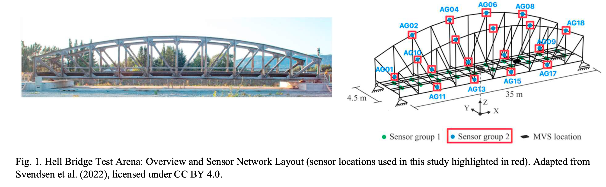
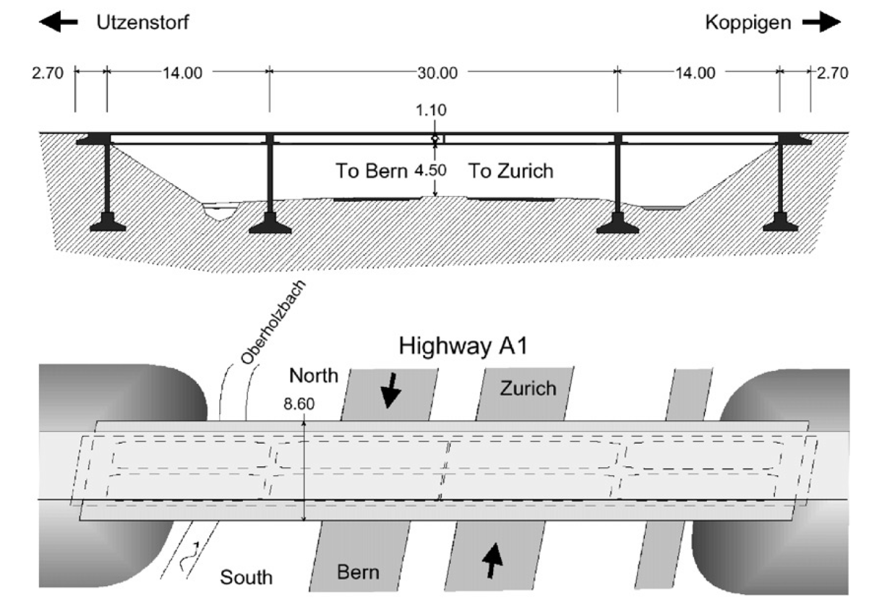

# Three-Bridge Data Availability

## Overall

Yes = present and usable / Partial = present but incomplete / No = missing

| Item | HBTA (5 Days)| Z24 (17 Days)| PMC (2 Days)|
|---|---|---|---|
| Bridge drawings | Yes | Partial | Yes |
| Rebar / material data | Partial | Partial | Yes |
| Boundary conditions | Yes | Yes | Yes |
| Sensor types and measurements | Yes | Yes | Yes |
| Load excitation | Partial | Yes | Partial |
| Damage | Partial | Partial | Partial |
| Dataset complete | Yes | Yes | No |
| Fillable from literature | Mostly | Partly | No |

Note: the data files do not contain a complete damage record. Damage existence is known from the state label, but location, type and extent must be taken from the corresponding documentation and publications.

## HBTA (steel riveted truss, 35 m)

| Item | Status | Detail |
|---|---|---|
| Drawings | Yes | 9 sheets; static calculation and bearing layout included;|
| Rebar / material | Partial | Steel, no rebar; E = 210 GPa, ρ = 7850 kg/m³ documented; steel grade unknown |
| Boundary conditions | Yes | Pinned one end, roller + longitudinal spring kx at the other; bearings marked on drawings |
| Sensors | Yes | Acceleration, strain;|
| Excitation | Partial | APS 420 log sweep; no force signal |
| Dataset complete | Yes | 50 records: 2 baselines + DS1–DS8, all 91 channels present |
| Literature | Mostly | Damage locations and FE parameters published; steel grade is not |

## Z24 (prestressed concrete box girder, 14+30+14 m)

| Item | Status | Detail |
|---|---|---|
| Drawings | Partial | 39-page appendix: general arrangement, one cross-beam rebar layout, tendon profiles; reference parameters from other publications |
| Rebar / material | Partial | Rebar given as positions for cross-beams only; grades not published |
| Boundary conditions | Yes | Skew bridge, 2 piers + abutment columns; soil springs|
| Sensors | Yes | PDT(Reaction acceleration, activation force); EMS(Acceleration, environmental factors, vehicle) |
| Excitation | Yes | Force channel in the forced-vibration files; FRF and EMA possible |
| Dataset complete | Yes | 17 damage scenarios, 18 .mat files each |
| Literature | Partly | FE updating method and parameters published; material grades are not |

## PMC (prestressed concrete 3-span, 93.5 m)

| Item | Status | Detail |
|---|---|---|
| Drawings | Yes | 8 original 1968 plans: formwork, prestressing, reinforcement, with material notes |
| Rebar / material | Yes | Rbk28 = 350 kg/cm², high-strength rebar, 2 cm cover, 220 t per tendon |
| Boundary conditions | Yes | About 30° skew, slight curvature, corroded bearings; requires spring supports and 3D model |
| Sensors | Yes | Acceleration, Strain |
| Excitation | Partial | Shaker at positions A and B; no force signal; label tables missing |
| Dataset complete | No | Day 3–4 data missing; the damage states used in the paper are absent |
| Literature | No | Missing measurements cannot be replaced by literature |
